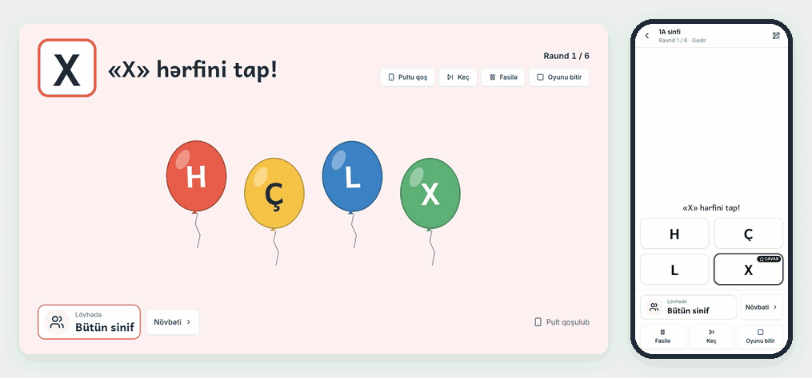
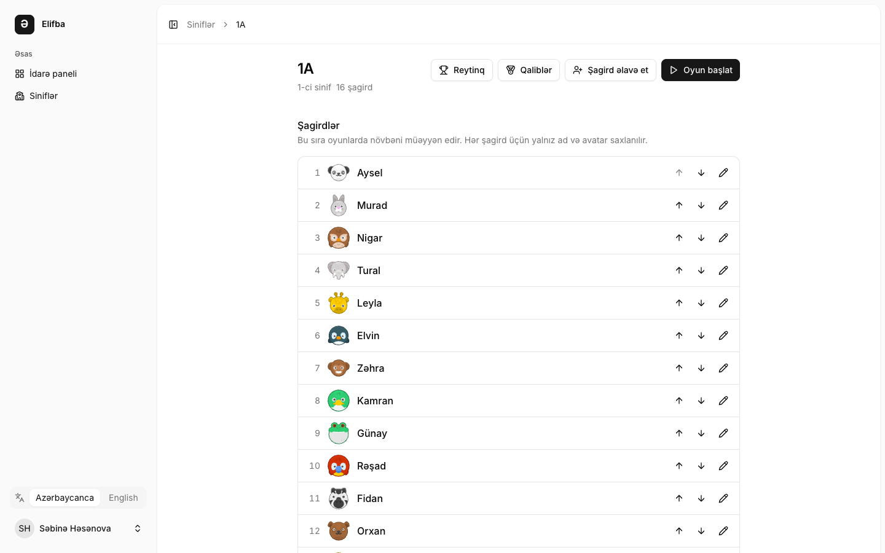
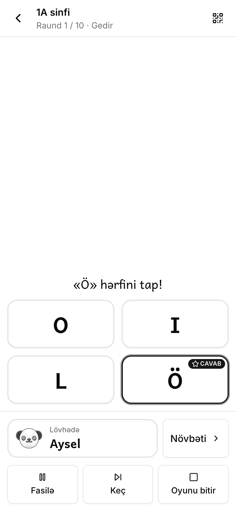
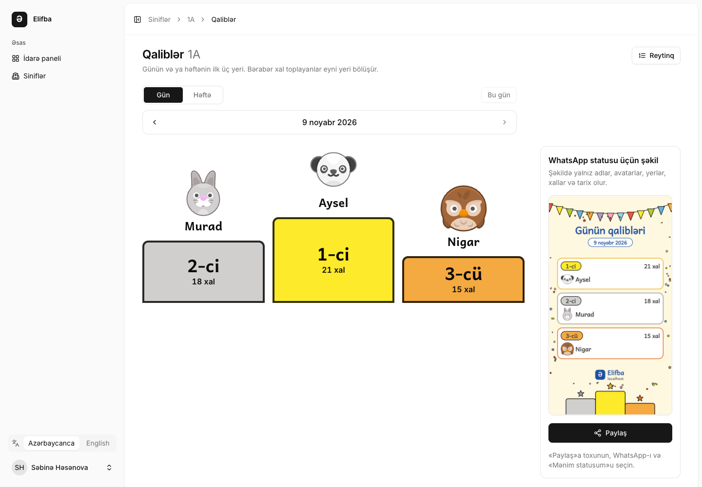

<p align="center">
  
</p>

<h1 align="center">Elifba</h1>

<p align="center">
  Oyunla oxu: sinif lövhəsində hərf, heca, söz və cümlə oyunları — müəllim onları telefonundan idarə edir.
</p>

<p align="center">
  Pulsuz və açıq mənbəlidir, 1-ci sinfin savad təlimi dərsləri üçün hazırlanıb. <a href="https://elifba.io"><strong>elifba.io</strong></a> ünvanında istifadə edin, heç nə quraşdırmaq lazım deyil.
</p>

<p align="center">
  <a href="https://github.com/nijataliyev7/elifba/actions/workflows/ci.yml"></a>
  <a href="LICENSE"></a>
  
  
  <a href="README.md"></a>
</p>

<p align="center">
  
</p>

## Nə edir

1. **Müəllim** qeydiyyatdan keçir, **sinif** yaradır və adların siyahısını yapışdıraraq **şagirdləri** əlavə edir. Elifba qısa adlar təklif edir və hər uşağa cizgi heyvan avatarı verir. Uşaqların hesabı olmur.
2. Müəllim proyektora qoşulmuş noutbukda **oyun** açır — bu, **lövhədir**. Oyun dörd mexanikadan biridir (hərfi, hecanı və ya sözü tap; heca qur; sözü yığ; cümlə qur) və altı temadan birində oynanır (qatar, şarlar, heyvanlar, meyvələr, şəhərlərimiz, milli rəmzlər). Oyunda yalnız sinfin öyrəndiyi hərflər olur.
3. Müəllim lövhədəki QR kodu skan edir və ya `/pult` ünvanında altırəqəmli kodu yazır — telefon **pulta** çevrilir. Uşaq divardakı elementə toxunur; elə həmin an müəllim onu telefonda basır və lövhə elementi partladır. Sinfə elə gəlir ki, divar uşağa cavab verdi. Toxunuşlu ekranda və ya siçanla telefonsuz da oynamaq olar, məktəbin ümumi kompüteri isə müəllim ona daxil olmadan **qonaq lövhəsi** (`/lovhe`) ola bilər.
4. Həll olunan raund lövhədəki uşağa xal gətirir. Hər sinfin günlük və həftəlik **reytinqi**, bir də **qaliblər** səhifəsi var. Oradakı şəkli müəllim WhatsApp statusunda paylaşa bilər: şəkildə yalnız adlar, avatarlar, yerlər, xallar və tarix olur.

İnterfeys əvvəlcə Azərbaycan dilindədir, ingilis dili də var; oxu materialı isə həmişə Azərbaycan dilindədir.

| Sinif: yalnız ad və avatar                                                                                                                    | Telefon pultu                                                                                                                                                                                         |
| --------------------------------------------------------------------------------------------------------------------------------------------- | ----------------------------------------------------------------------------------------------------------------------------------------------------------------------------------------------------- |
|  |  |



## Kömək edin

Elifba müəllimlərlə birlikdə hazırlanır və ona lazım olan köməyin çoxu kod deyil:

- **Sinifdə yoxlayın** və nəyin işlədiyini, nəyin işləmədiyini yazın: [ideya](https://github.com/nijataliyev7/elifba/issues/new?template=2-idea.yml), sualınızı isə [Discussions](https://github.com/nijataliyev7/elifba/discussions) bölməsində verin.
- **Məzmunu yoxlayın.** Səhv söz, heca bölgüsü, cümlə və ya şəkil üçün [məzmun düzəlişi](https://github.com/nijataliyev7/elifba/issues/new?template=3-content.yml) göndərin; hər temaya yeni sözlər və cümlələr də əlavə etmək olar.
- **İnterfeysi başqa dilə tərcümə edin**: cəmi iki fayldır, [CONTRIBUTING](CONTRIBUTING.md#translations) izah edir.
- **Kod yazın:** [good first issue](https://github.com/nijataliyev7/elifba/labels/good%20first%20issue) etiketli issue-lar başlamaq üçün yaxşıdır, aşağıdakı «İnkişaf» bölməsi isə qurulumu göstərir.
- **Repoya ulduz verin** ki, başqa müəllimlər və proqramçılar onu tapsın.

## İnkişaf

`intl` genişlənməsi olan PHP 8.4, Composer 2 və Node.js 22 lazımdır. İnkişaf SQLite ilə işləyir, başqa heç nə quraşdırmaq lazım deyil. [Laravel Herd](https://herd.laravel.com) (macOS, Windows) bunların hamısını verir və tətbiqi `http://elifba.test` ünvanında açır.

```bash
git clone https://github.com/nijataliyev7/elifba.git ~/Herd/elifba
cd ~/Herd/elifba
composer setup     # Composer və npm paketləri, .env, tətbiqin və Reverb-in açarları, SQLite bazası, build
composer dev       # Vite, Reverb, loglar və artisan serve
```

`http://elifba.test` (Herd) və ya `http://localhost:8000` (Herd-siz) ünvanını açıb qeydiyyatdan keçin: ilk hesab da başqaları kimi müəllim hesabıdır. İnkişafda məktublar loga yazılır; e-poçtu təsdiqləyən keçid bu əmrin göstərdiyi sonuncu keçiddir:

```bash
tr -d '\r' < storage/logs/laravel.log | grep -oE 'https?://[^] ()<]+/email/verify/[^] ()<]+$' | tail -n 1
```

- **Əsl telefon pult kimi.** Telefonlar `elifba.test` ünvanını tanımır. `composer dev`-i dayandırıb əvəzinə `composer dev:lan` işə salın: o, tətbiqi və Reverb-i noutbukun yerli şəbəkə ünvanında açır və həmin ünvanı göstərir (`http://192.168.1.20:8000`). Bu ünvanı noutbukda da açın, daxil olun, oyun başladın, eyni Wi-Fi-dakı telefonda isə `/pult` səhifəsini açın. `.env` dəyişmir.
- **Qaliblər şəkli üçün HTTPS.** Qaliblər səhifəsindəki «Paylaş» düyməsi (Web Share API) yalnız https-də işləyir. `herd secure elifba` işə salın və `.env` faylındakı Reverb sətirlərini onların üstündəki şərhdə yazıldığı kimi dəyişin; bundan sonra `composer dev` tətbiqi `https://elifba.test`, Reverb-i isə `wss` ilə açır. Telefonda yoxlamaq üçün `composer dev` işləyərkən `herd share` işə salın.
- **Pull request-dən əvvəl:** `composer ci:check` — CI-nin işlətdiyi eyni yoxlama: oxlint və oxfmt, `tsc`, Vitest, Pint, PHPStan 8-ci səviyyə və Pest. `npm run check:fix` və `composer lint` formatı özləri düzəldir.

Kod:

- **Texnologiyalar:** Laravel 13, Inertia 3, React 19, TypeScript, Tailwind 4, shadcn/ui, lövhə üçün Phaser, telefon üçün Laravel Reverb, Wayfinder, Pest. Rəsmi Laravel React starter kit üzərində qurulub.
- **Dizayn:** [`docs/architecture.md`](docs/architecture.md) kodun əməl etdiyi müqavilədir; [`docs/glossary.md`](docs/glossary.md) Azərbaycan terminlərini koddakı adlarla uyğunlaşdırır; [`docs/decisions/`](docs/decisions/) geri qaytarılması çətin qərarları saxlayır; [`docs/frontend.md`](docs/frontend.md) interfeys qaydalarıdır. Sənədlər ingiliscədir.
- **Domenlər:** `app/Domain/{Language,Content,Classroom,Play,Rankings}`, bu ardıcıllıqla bir istiqamətdə.
- **Məzmun:** hərflər, sözlər, cümlələr, tapşırıqlar və temaların şəkilləri [`content/`](content/) qovluğundakı fayllardır; `php artisan content:validate` onları yoxlayır.
- **Dillər:** `lang/az.json` (əsas) və `lang/en.json`; test onların açarlarını eyni saxlayır.
- **CI:** GitHub Actions `composer ci:check` yoxlamasını SQLite-da, Pest testlərini PostgreSQL 17-də, [`scripts/docker-smoke.sh`](scripts/docker-smoke.sh) skriptini isə Docker yığınında işlədir.

Kömək etmək üçün [CONTRIBUTING.md](CONTRIBUTING.md), kod agentlərinin qaydaları üçün [CLAUDE.md](CLAUDE.md) faylına baxın.

## Öz serverinizdə

Məktəb, müəllim və ya təşkilat Elifba-nı Docker ilə öz serverində işlədə bilər. Hər şey bir `docker compose` yığınındadır: Caddy (https və sertifikat), tətbiq (nginx və PHP-FPM), telefonlar üçün Reverb, planlayıcı, PostgreSQL 17 və bazanın gecəlik ehtiyat nüsxəsi. Ətraflı: [arxitektura §10](docs/architecture.md#10-hosting) (ingiliscə).

**Lazım olanlar:** 64 bitlik Linux, 2 GB yaddaş və 10 GB disk olan server, Compose plagini ilə Docker Engine (`docker compose version` v2 göstərir), `git` və `openssl`, bir də domen və ya subdomen.

**DNS.** Ad üçün (məsələn, `elifba.example.az`) serverə yönələn `A` yazısı (serverin IPv6 ünvanı varsa, `AAAA` yazısı da) yaradın və serverin firewall-unda 80 və 443 portlarını açın. Ad serverə çatan kimi Caddy onun üçün Let's Encrypt sertifikatını özü alır və yeniləyir.

**Ayarlar.** İnkişaf qovluğunuzu yox, yeni klonu istifadə edin: yığın repozitoriyanın kökündəki öz `.env` faylını oxuyur. `scripts/docker-env.sh` həmin `.env` faylını [`.env.production.example`](.env.production.example) əsasında sizin domen və yeni sirlərlə (`APP_KEY`, Reverb-in açarları, bazanın parolu) yazır və mövcud faylın üzərinə heç vaxt yazmır.

```bash
git clone https://github.com/nijataliyev7/elifba.git
cd elifba
scripts/docker-env.sh elifba.example.az
```

Sonra `.env` faylını açın (`nano .env`) və doldurun:

- `ELIFBA_OPERATOR_NAME` və `ELIFBA_OPERATOR_EMAIL`: bu serverə cavabdeh olan şəxs və ya məktəb. Məxfilik səhifəsi (`/privacy`) onları məlumatı saxlayan və valideynlərə cavab verən tərəf kimi göstərir.
- `MAIL_*` sətirləri (`MAIL_MAILER=smtp`, host, port, istifadəçi, parol, göndərən ünvan): müəllimlər e-poçtlarını təsdiqləmək və parolu bərpa etmək üçün məktub alırlar. O vaxta qədər məktublar loga yazılır (aşağıya baxın).
- İstəyə görə: `GOOGLE_CLIENT_ID` və `GOOGLE_CLIENT_SECRET` — müəllimlər Google ilə daxil ola bilsin deyə (Google Cloud Console-da "Web application" tipli OAuth client, yönləndirmə ünvanı `https://<domeniniz>/auth/google/callback`; [ADR 008](docs/decisions/008-google-sign-in.md)). Google-un təsdiqlədiyi Gmail və ya Google Workspace ünvanı müəllimin ünvanını da məktubsuz təsdiqləyir. Boş = Google düyməsi yoxdur.

**İşə salmaq.**

```bash
docker compose up -d --build --wait
```

İlk build bir neçə dəqiqə çəkir. Əmr bütün xidmətlər sağlam olanda qayıdır; `docker compose ps` onları göstərir, `docker compose logs -f app` isə logu izləyir. Tətbiq hər dəfə başlayanda bazanın miqrasiyalarını işlədir.

**İlk müəllim.** `https://elifba.example.az/register` ünvanını açıb qeydiyyatdan keçin. Ünvanı aça bilən hər kəs müəllim kimi qeydiyyatdan keçə bilər və hər müəllim yalnız öz siniflərini görür. SMTP olmayanda təsdiq keçidi logdadır:

```bash
docker compose logs app | tr -d '\r' | grep -oE 'https?://[^] ()<]+/email/verify/[^] ()<]+$' | tail -n 1
```

Telefonlar `https://elifba.example.az/pult` ünvanını açır.

**`.env` dəyişəndə.** Operatoru və ya poçtu dəyişəndən sonra `docker compose up -d --wait` işə salın; konteynerlər yeni dəyərlərlə yenidən yaradılır. `ELIFBA_DOMAIN`, `ELIFBA_SCHEME`, `ELIFBA_PORT` və ya `REVERB_APP_KEY` dəyişəndən sonra isə `docker compose up -d --build --wait` lazımdır: brauzerin Reverb ünvanı build zamanı fayllara yazılır.

**Ehtiyat nüsxələr.** `backup` xidməti hər gecə Bakı vaxtı ilə saat 03:00-da bazanın nüsxəsini `backups` həcminə yazır və 14 gün saxlayır (`.env` faylında `BACKUP_AT`, `BACKUP_KEEP_DAYS`). İndi nüsxə çıxarmaq, nüsxələrin siyahısına baxmaq və onları Docker həcmindən kənara köçürmək:

```bash
docker compose exec backup elifba-backup now
docker compose exec backup ls -lh /backups
docker compose cp backup:/backups ~/elifba-backups
```

Bir nüsxəni başqa kompüterdə də saxlayın. Nüsxəni bərpa etmək üçün (o, bazadakı hər şeyi əvəz edir) yazan xidmətləri dayandırın, bərpa edin və yenidən işə salın:

```bash
docker compose stop app reverb scheduler
docker compose exec backup pg_restore --clean --if-exists --no-owner -d elifba /backups/elifba-2026-11-09_030000.dump
docker compose up -d --wait
```

Başqa kompüterdən gələn nüsxə əvvəlcə həcmə köçürülür: `docker compose cp elifba-2026-11-09_030000.dump backup:/backups/`.

**Yeniləmək.** Ehtiyat nüsxə çıxarın, sonra yeni kodu çəkib yenidən build edin; tətbiq başlayanda bazanı özü miqrasiya edir.

```bash
docker compose exec backup elifba-backup now
git pull
docker compose up -d --build --wait
```

**Öz kompüterinizdə sınamaq.** Domen olmadan eyni yığın sertifikatsız, adi http ilə işləyir və 80, 443 portlarına toxunmur (Docker Desktop kifayətdir):

```bash
git clone https://github.com/nijataliyev7/elifba.git elifba-docker
cd elifba-docker
scripts/docker-env.sh localhost http 8088
docker compose up -d --build --wait
```

`http://localhost:8088/register` ünvanını açın; təsdiq keçidi yuxarıdakı kimi logdadır. Eyni Wi-Fi-dakı telefonlar üçün `localhost` əvəzinə kompüterin yerli şəbəkə ünvanını verin (`scripts/docker-env.sh 192.168.1.20 http 8088`) və telefonda `http://192.168.1.20:8088/pult` ünvanını açın. Brauzerlər http-də qaliblər şəklinin «Paylaş» düyməsini göstərmir; «Şəkli yüklə» düyməsi işləyir. `docker compose down` yığını dayandırır və məlumatı saxlayır; `docker compose down --volumes` isə məlumatı və ehtiyat nüsxələri də silir. Əsl domenə keçmək üçün bu `.env` faylını başqa yerə köçürüb `scripts/docker-env.sh` skriptini yenidən işə salın.

## Məxfilik

Elifba uşaqlar haqqında minimum məlumat saxlayır: ad (iki eyni adlı uşağı ayırmaq üçün yalnız soyadın ilk hərfi) və cizgi avatarı — hamısı bir müəllimə aiddir. Şagird girişi, şəkil, doğum tarixi, üçüncü tərəf skriptləri, şriftləri və analitikası yoxdur. Şagirdi və ya sinfi silmək onu həqiqətən silir. Ətraflı: [arxitektura §7](docs/architecture.md#7-childrens-privacy).

## Təhlükəsizlik

Zəiflikləri gizli bildirin; [SECURITY.md](SECURITY.md) faylına baxın.

## Lisenziya

Elifba-nın kodu və öz təsvirləri [MIT](LICENSE) lisenziyası ilədir. Başqalarının faylları öz lisenziyalarını saxlayır: `content/assets/openmoji/` qovluğundakı OpenMoji şəkilləri CC BY-SA 4.0, `resources/fonts/` qovluğundakı şriftlər SIL Open Font License 1.1 lisenziyası ilədir, Kenney-nin avatarları və səsləri isə CC0 1.0 ilə hamıya açıqdır. Şəklin göstərilməsi onu göstərən kodun lisenziyasını dəyişmir.

All emojis designed by [OpenMoji](https://openmoji.org/) – the open-source emoji and icon project. License: [CC BY-SA 4.0](https://creativecommons.org/licenses/by-sa/4.0/). Hər aktivin müəllifi, mənbəyi və lisenziyası [CREDITS.md](CREDITS.md) faylında (və tətbiqin `/credits` səhifəsində) göstərilir.
