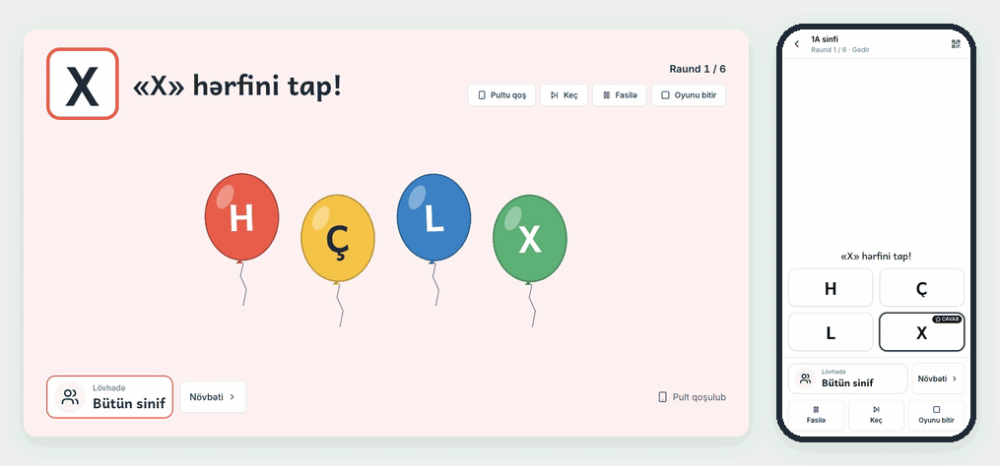
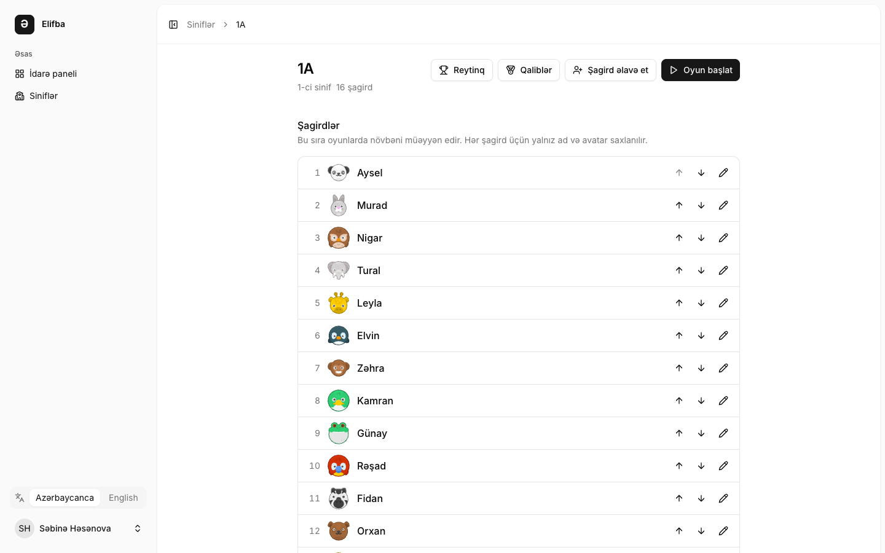
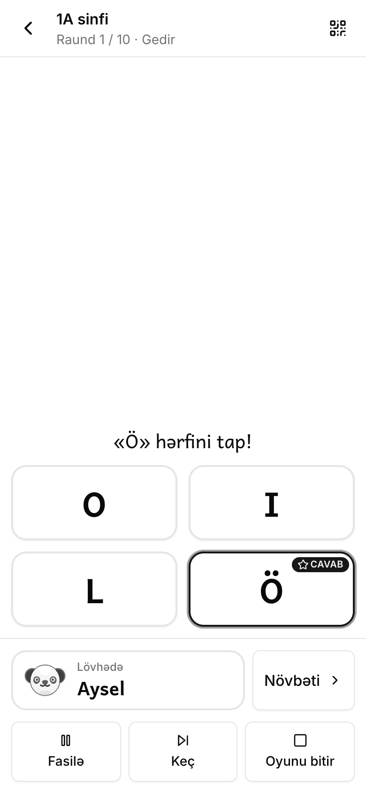
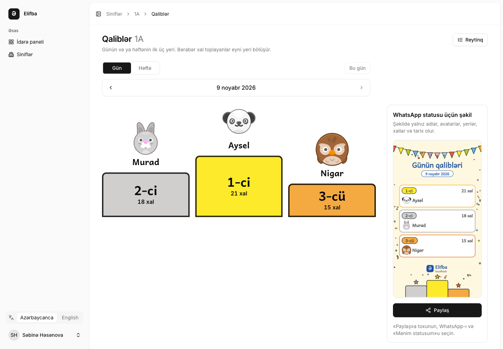
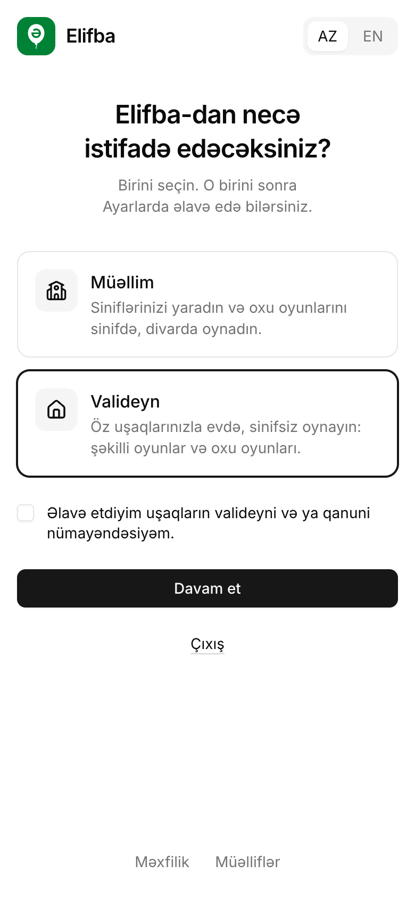
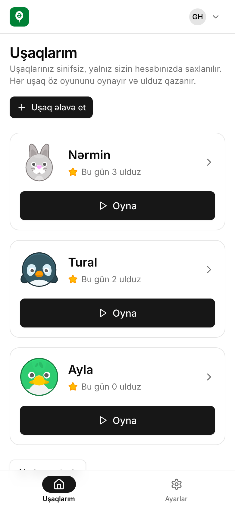
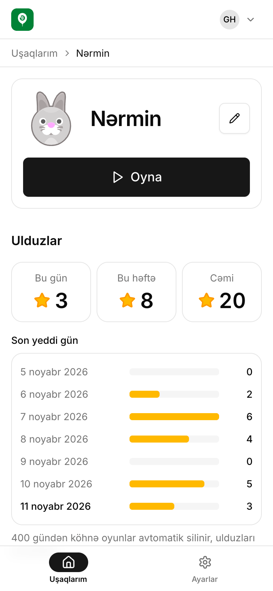
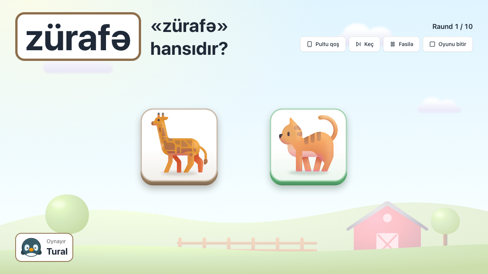
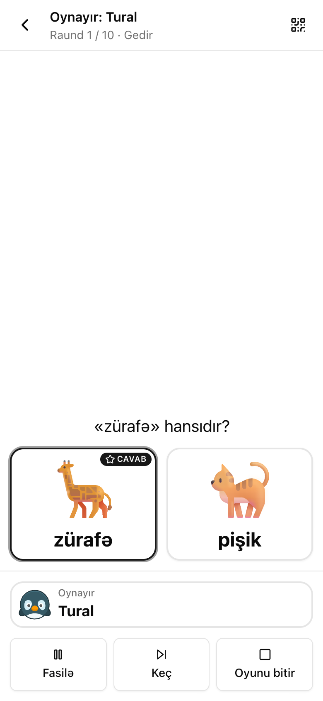

<p align="center">
  
</p>

<h1 align="center">Elifba</h1>

<p align="center">
  Learn to read Azerbaijani by playing: short letter, syllable, word and sentence games on the classroom wall, driven from the teacher's phone.
</p>

<p align="center">
  Free and open source, made for first-grade reading lessons and for parents at home. Use it at <a href="https://elifba.io"><strong>elifba.io</strong></a>, with nothing to install.
</p>

<p align="center">
  <a href="https://github.com/nijataliyev7/elifba/actions/workflows/ci.yml"></a>
  <a href="LICENSE"></a>
  
  
  <a href="README.az.md"></a>
</p>

<p align="center">
  
</p>

## What it does

1. A **teacher** registers, chooses «Müəllim» (Teacher), creates a **class** and adds **students** by pasting a list of first names. Elifba suggests short display names and gives every child a cartoon animal. Children never get an account.
2. The teacher opens a **game** on the laptop connected to the projector: the **board**. A game is one of six mechanics (find a letter, syllable, word or picture; read and tap; build a syllable; build a word; build a sentence; count) in one of eight themes (train, balloons, animals, fruit, our cities, national symbols, colours, numbers). Reading games use only the letters the class has learned.
3. The teacher scans the board's QR code, or types its six-digit code at `/pult`, and the phone becomes the **remote**. A child touches an item on the wall; at the same moment the teacher taps it on the phone, and the board bursts it. To the class it looks as if the wall reacted to the child. A touch screen or a mouse works without a phone, and a shared school computer can be a **guest board** (`/lovhe`) without the teacher logging in on it.
4. Solved rounds give points to the child at the board. Each class has a daily and a weekly **ranking**, and a **podium** with an image the teacher can share as a WhatsApp status: names, avatars, places, points and the date, nothing else.

**The board speaks.** It says each round's prompt aloud in Azerbaijani («Dovşan hansıdır?», «Ba hecasını tap!») and praises a solved round («Afərin!»). The voice is synthetic: about nine hundred clips made once with ElevenLabs and shipped in the repository, so nothing is synthesised while you play and no key is needed to run Elifba. It never says a name, and a prompt with a teacher's own word stays silent. Each account can turn the prompt or the praise off in Settings.

The interface is Azerbaijani first, with English; the reading content is always Azerbaijani.

| The class: names and avatars, nothing else                                                                                                             | The phone remote                                                                                                                                                                                              |
| ------------------------------------------------------------------------------------------------------------------------------------------------------ | ------------------------------------------------------------------------------------------------------------------------------------------------------------------------------------------------------------- |
|  |  |



## At home, for parents

Elifba works without a class too. A **parent** registers, chooses «Valideyn» (Parent) and adds their **children**: a first name and a cartoon animal each, up to ten. One account can be a teacher and a parent at once; the second role is added later in Settings.

- **Picture and number games** for children of three to six who cannot read yet: find the animal, fruit or colour the parent names, say a picture's name and tap it, count pictures, and recognise the numbers 1 to 10. The board says the prompt aloud («Dovşan hansıdır?», «Neçə alma var?»), so a child who cannot read yet can play; the parent can still read it instead.
- **The reading games** of the classroom, for a child who is starting to read, built from the letters that child has learned.
- **The same board and remote.** The board opens on a laptop or a tablet at home; the phone becomes the remote, or the child touches the screen.
- **Stars, not rankings.** Each child collects stars by day and by week. Brothers and sisters are never compared: there is no ranking, place, podium or share card at home.

| Choose the role                                                                                                                                                              | Your children                                                                                                                                                        | A child's stars                                                                                                                                             |
| ---------------------------------------------------------------------------------------------------------------------------------------------------------------------------- | -------------------------------------------------------------------------------------------------------------------------------------------------------------------- | ----------------------------------------------------------------------------------------------------------------------------------------------------------- |
|  |  |  |

| A picture game at home                                                                                                                                        | The parent's remote                                                                                                                                                                        |
| ------------------------------------------------------------------------------------------------------------------------------------------------------------- | ------------------------------------------------------------------------------------------------------------------------------------------------------------------------------------------ |
|  |  |

## Help

Elifba is made together with teachers, and most of the help it needs is not code:

- **Try it in your class** and tell what works and what does not: [an idea](https://github.com/nijataliyev7/elifba/issues/new?template=2-idea.yml), or a question in [Discussions](https://github.com/nijataliyev7/elifba/discussions).
- **Check the content.** A wrong word, syllable split, sentence or picture is [a content correction](https://github.com/nijataliyev7/elifba/issues/new?template=3-content.yml), and every theme can take more words and sentences.
- **Translate the interface** into another language: it is two files, as [CONTRIBUTING](CONTRIBUTING.md#translations) explains.
- **Write code:** issues marked [good first issue](https://github.com/nijataliyev7/elifba/labels/good%20first%20issue) are a good start, and [Develop](#develop) below sets you up.
- **Star the repository**, so that other teachers and developers find it.

## Develop

You need PHP 8.4 with the `intl` extension, Composer 2 and Node.js 22. Development runs on SQLite, so there is nothing else to install. [Laravel Herd](https://herd.laravel.com) (macOS, Windows) has all of it and serves the app at `http://elifba.test`.

```bash
git clone https://github.com/nijataliyev7/elifba.git ~/Herd/elifba
cd ~/Herd/elifba
composer setup     # Composer and npm packages, .env, app and Reverb keys, the SQLite database, built assets
composer dev       # Vite, Reverb, the log tail and artisan serve
```

Open `http://elifba.test` (Herd) or `http://localhost:8000` (without Herd) and register, then choose a role («Müəllim» or «Valideyn»); the first account is like every other. Mail goes to the log in development; the link that confirms the address is the last one this prints:

```bash
tr -d '\r' < storage/logs/laravel.log | grep -oE 'https?://[^] ()<]+/email/verify/[^] ()<]+$' | tail -n 1
```

- **A real phone as the remote.** Phones cannot resolve `elifba.test`. Stop `composer dev` and run `composer dev:lan` instead: it serves the app and Reverb on the laptop's LAN address and prints it (`http://192.168.1.20:8000`). Open that address on the laptop too, log in, start a game, and open `/pult` on a phone on the same Wi-Fi. `.env` is not changed.
- **HTTPS for the share card.** The podium's Share button (the Web Share API) works only on https. Run `herd secure elifba` and change the Reverb lines in `.env` as the comment above them describes; `composer dev` then serves `https://elifba.test` with `wss` for Reverb. To try it on a phone, run `herd share` while `composer dev` is running.
- **Before a pull request:** `composer ci:check`, the same gate CI runs: oxlint and oxfmt, `tsc`, Vitest, Pint, PHPStan level 8 and Pest. `npm run check:fix` and `composer lint` fix formatting.

The code:

- **Stack:** Laravel 13, Inertia 3, React 19, TypeScript, Tailwind 4, shadcn/ui, Phaser for the board, Laravel Reverb for the phone, Wayfinder, Pest. Built on the official Laravel React starter kit.
- **Design:** [`docs/architecture.md`](docs/architecture.md) is the contract the code follows; [`docs/glossary.md`](docs/glossary.md) maps Azerbaijani terms to code names; [`docs/decisions/`](docs/decisions/) records the hard-to-reverse choices; [`docs/frontend.md`](docs/frontend.md) has the UI rules.
- **Domains:** `app/Domain/{Language,Content,Classroom,Family,Play,Rankings}`, one-way in that order.
- **Content:** letters, words, sentences, prompts and theme pictures are files in [`content/`](content/), checked by `php artisan content:validate`.
- **Languages:** `lang/az.json` (base) and `lang/en.json`; a test keeps them in step.
- **CI:** GitHub Actions runs `composer ci:check` on SQLite, the Pest suite on PostgreSQL 17, and [`scripts/docker-smoke.sh`](scripts/docker-smoke.sh) against the Docker stack.

See [CONTRIBUTING.md](CONTRIBUTING.md) to help, and [CLAUDE.md](CLAUDE.md) for the rules coding agents follow.

## Run your own instance

A school, a teacher or an organisation can run its own Elifba with Docker. One `docker compose` stack holds everything: Caddy (https and the certificate), the app (nginx and PHP-FPM), Reverb for the phones, the scheduler, PostgreSQL 17 and a nightly database backup. [Architecture §10](docs/architecture.md#10-hosting) describes it in full.

**You need** a server with a 64-bit Linux, 2 GB of memory and 10 GB of disk, Docker Engine with the Compose plugin (`docker compose version` shows v2), `git` and `openssl`, and a domain or subdomain.

**DNS.** Point an `A` record (and an `AAAA` record if the server has IPv6) for the name, for example `elifba.example.az`, at the server, and open ports 80 and 443 in its firewall. Caddy gets and renews a Let's Encrypt certificate for the name by itself once the name reaches the server.

**Configure.** Use a fresh clone, not your development folder: the stack reads its own `.env` in the repository's root. `scripts/docker-env.sh` writes that `.env` from [`.env.production.example`](.env.production.example) with your domain and fresh secrets (`APP_KEY`, Reverb's keys, the database password), and never overwrites an existing one.

```bash
git clone https://github.com/nijataliyev7/elifba.git
cd elifba
scripts/docker-env.sh elifba.example.az
```

Then open `.env` (`nano .env`) and fill in:

- `ELIFBA_OPERATOR_NAME` and `ELIFBA_OPERATOR_EMAIL`: the person or school responsible for this instance. The privacy page (`/privacy`) names them as the one who keeps the data and answers parents.
- The `MAIL_*` lines (`MAIL_MAILER=smtp`, host, port, user, password, from address): teachers confirm their address and reset passwords by mail. Until then mail goes to the log (see below).
- Optional: `GOOGLE_CLIENT_ID` and `GOOGLE_CLIENT_SECRET`, to let teachers sign in with Google (an OAuth client of type "Web application" in Google Cloud Console, with the redirect URI `https://<your domain>/auth/google/callback`; [ADR 008](docs/decisions/008-google-sign-in.md)). A Gmail or Google Workspace address confirmed by Google also confirms the teacher's, without mail. Empty = no Google button.

**Start.**

```bash
docker compose up -d --build --wait
```

The first build takes a few minutes. The command returns when every service is healthy; `docker compose ps` shows them, and `docker compose logs -f app` follows the log. The app runs its database migrations each time it starts.

**The first account.** Open `https://elifba.example.az/register` and register. Anyone who can open the address can register as a teacher or a parent, and each account sees only its own classes and children. Without SMTP, the confirmation link is in the log:

```bash
docker compose logs app | tr -d '\r' | grep -oE 'https?://[^] ()<]+/email/verify/[^] ()<]+$' | tail -n 1
```

Phones open `https://elifba.example.az/pult`.

**Changing `.env`.** After changing the operator or mail, run `docker compose up -d --wait`; the containers are recreated with the new values. After changing `ELIFBA_DOMAIN`, `ELIFBA_SCHEME`, `ELIFBA_PORT` or `REVERB_APP_KEY`, run `docker compose up -d --build --wait`: the browser's Reverb address is built into the assets.

**Backups.** The `backup` service dumps the database every night at 03:00 Baku time into the `backups` volume and keeps 14 days (`BACKUP_AT`, `BACKUP_KEEP_DAYS` in `.env`). Make a dump now, list the dumps, and copy them off the server's Docker volume:

```bash
docker compose exec backup elifba-backup now
docker compose exec backup ls -lh /backups
docker compose cp backup:/backups ~/elifba-backups
```

Keep a copy on another machine too. To restore a dump (it replaces everything in the database), stop the services that write, restore, and start again:

```bash
docker compose stop app reverb scheduler
docker compose exec backup pg_restore --clean --if-exists --no-owner -d elifba /backups/elifba-2026-11-09_030000.dump
docker compose up -d --wait
```

A dump from another machine first goes into the volume: `docker compose cp elifba-2026-11-09_030000.dump backup:/backups/`.

**Updating.** Make a backup, then pull and rebuild; the app migrates the database when it starts.

```bash
docker compose exec backup elifba-backup now
git pull
docker compose up -d --build --wait
```

**Try it on your own computer.** Without a domain, the same stack runs over plain http, without certificates and without touching ports 80 and 443 (Docker Desktop is enough):

```bash
git clone https://github.com/nijataliyev7/elifba.git elifba-docker
cd elifba-docker
scripts/docker-env.sh localhost http 8088
docker compose up -d --build --wait
```

Open `http://localhost:8088/register`; the confirmation link is in the log as above. For phones on the same Wi-Fi, give the computer's LAN address instead of `localhost` (`scripts/docker-env.sh 192.168.1.20 http 8088`) and open `http://192.168.1.20:8088/pult` on the phone. Browsers do not offer the share card's Share button over http; its Download button works. `docker compose down` stops the stack and keeps the data; `docker compose down --volumes` deletes the data and the backups too. To move on to a real domain, move this `.env` away and run `scripts/docker-env.sh` again.

## Privacy

Elifba stores the minimum about children: a first name (and a surname initial only to tell two apart) and a cartoon avatar, owned by one teacher. A parent's child is the same: a first name and an avatar, owned by one parent, with no age or birth date. No student login, no photos, no birth dates, no third-party scripts, fonts or analytics. Deleting a student, a class or a child deletes it. Details: [architecture §7](docs/architecture.md#7-childrens-privacy).

## Security

Please report vulnerabilities privately; see [SECURITY.md](SECURITY.md).

## License

Elifba's code and its own art are under the [MIT License](LICENSE). Files made by others keep their own licenses: the Fluent Emoji pictures in `content/assets/fluent/` are © Microsoft Corporation under the MIT License, the fonts in `resources/fonts/` under the SIL Open Font License 1.1, and Kenney's avatars and sounds are CC0 1.0 (public domain). The board's voice in `content/assets/voice/` is synthetic speech made for Elifba with ElevenLabs, under the MIT License too.

[CREDITS.md](CREDITS.md) lists every asset with its author, source and license (and the app shows the same list at `/credits`).
